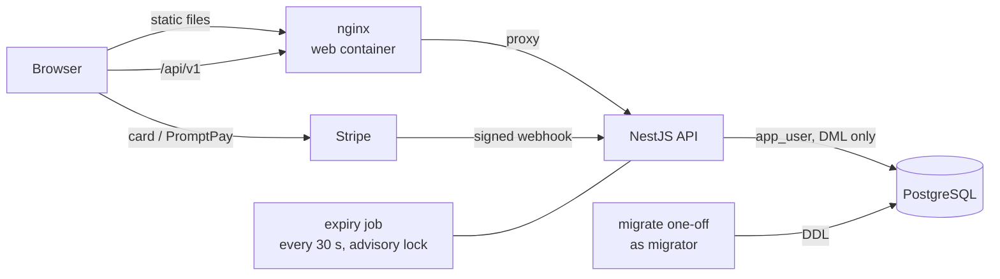

# Movie Ticketing

A full-stack movie ticketing app for Thailand. Customers browse movies in **Thai or English**, pick 1–4 seats, log in,
pay within 5 minutes by **card or PromptPay** and get a **ticket QR**.

Next.js 16 (static export) · NestJS 12 · PostgreSQL 17 · Prisma 7 · Stripe · Turborepo · Vitest · Playwright.

## Run the whole stack (one command)

Needs Docker and Node 24.

```bash
npm ci
npm run stack:up        # postgres -> migrate -> seed -> api -> web
open http://localhost:8080
```

Log in with the demo account `demo@example.com` / `demo-password-123`, or register a new one.

`stack:up` creates `.env` from `.env.example` and adds random API secrets the first time. `npm run stack:logs`
tails the API and web, `npm run stack:down` stops everything (the database volume is kept).

## Payments

| `PAYMENTS_PROVIDER` | What happens at checkout                                                                                                |
| ------------------- | ----------------------------------------------------------------------------------------------------------------------- |
| `fake` (default)    | A demo panel: "Pay" / "Simulate scan & pay" confirms the booking through the same webhook handler Stripe would trigger. |
| `stripe`            | Stripe's Payment Element (card + PromptPay QR), THB, test mode.                                                         |

To use Stripe test mode, put your keys in `.env`:

```bash
PAYMENTS_PROVIDER=stripe
STRIPE_SECRET_KEY=sk_test_...
STRIPE_PUBLISHABLE_KEY=pk_test_...
STRIPE_WEBHOOK_SECRET=whsec_...   # printed by the stripe-cli container (below)
```

```bash
docker compose --profile stack --profile stripe up -d --build
docker compose logs stripe-cli | grep whsec_   # copy into STRIPE_WEBHOOK_SECRET, then up -d again
```

Test cards: `5555 5555 5555 4444` (Mastercard, succeeds), `4000 0000 0000 0002` (declined), any future expiry and CVC.
PromptPay in test mode shows a QR with "authorize" / "fail" buttons.

## Develop

```bash
npm run db:up                 # Postgres only, on 127.0.0.1:5433
npm run db:migrate && npm run db:seed
npm run dev -w api            # API on :4000 (Swagger at /api/docs)
npm run dev:api -w web        # web on :3000 talking to the API
npm run dev:mock -w web       # or: web on :3000 with the mock API, no backend needed
```

## Tests

```bash
npm run check                 # format, contract lint, lint, typecheck, unit tests, build
npm run test:int -w api       # API integration tests on a real Postgres (Testcontainers, needs Docker)
```

End to end against the running stack (the suite logs in several times, so raise the auth rate limit):

```bash
RATE_LIMIT_AUTH_PER_MIN=100 npm run stack:up
npx -w e2e playwright install chromium
npm run e2e
```

## Environment

| File                       | Used by                                    | Notes                                                       |
| -------------------------- | ------------------------------------------ | ----------------------------------------------------------- |
| `.env` (root)              | Docker Compose                             | DB passwords, API secrets, payments, `WEB_HOST_PORT` (8080) |
| `apps/api/.env`            | `npm run dev -w api`, Prisma CLI, the seed | every key is documented in `apps/api/.env.example`          |
| `NEXT_PUBLIC_API_BASE_URL` | the web build                              | `/api/v1` (same origin) unless the API lives elsewhere      |

The API validates its environment at start and refuses placeholder secrets when `NODE_ENV=production`.

## Architecture



- **Bookings** lock seats in one transaction (partial unique index decides races), hold them for 6 minutes and must
  be paid within 5. The expiry job cancels unpaid ones; a payment that still arrives is refunded automatically.
- **A booking is confirmed only by the verified webhook**, never by the browser.
- Design docs: `docs/openapi.yaml` (API contract), `docs/database-design.md`, `docs/security.md`, `plan.md`.

Movie data and images: this product uses the TMDB API but is not endorsed or certified by TMDB.
