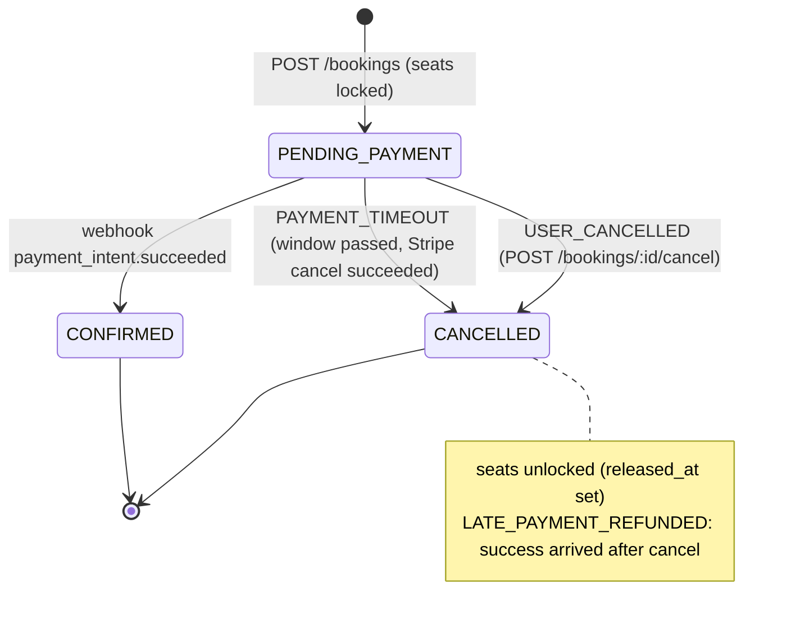

# Database Design (MVP)

PostgreSQL. The ER diagram source lives in [`er-diagram.mmd`](./er-diagram.mmd) and is rendered at `/er-diagram`.

## Scope

The MVP covers the customer side only: browse movies (Thai / English), pick a showtime and seats, log in, pay with
**card (Mastercard/Visa)** or **PromptPay QR** through Stripe, and receive a ticket QR code.
There is no admin UI yet. Movies, cinemas, halls, seats and showtimes come from a **seed script**.

## Business rules

| Rule                                 | Value                                                           | Where it's enforced                                                       |
| ------------------------------------ | --------------------------------------------------------------- | ------------------------------------------------------------------------- |
| Max seats per booking                | **4**                                                           | API validation                                                            |
| Active bookings per user             | **1** `PENDING_PAYMENT` at a time                               | partial unique index + API (`409 ACTIVE_BOOKING_EXISTS`)                  |
| Payment window                       | **5 min** after the booking is created                          | `bookings.payment_expires_at`, then the Stripe PaymentIntent is cancelled |
| Seat hold                            | **6 min** after the booking is created                          | `bookings.hold_expires_at`                                                |
| Booking cut-off                      | until **30 min after** `showtimes.starts_at`                    | API validation                                                            |
| Refunds / cancellation after payment | **none** (only an automatic refund for a late payment, rule 3d) | –                                                                         |
| Timezone                             | all cinemas use **Asia/Bangkok**                                | app constant. "Date" = Bangkok calendar day                               |
| Currency                             | THB, **whole baht**                                             | integer columns `*_baht`                                                  |
| Languages                            | **Thai (default)**, English                                     | `*_th` / `*_en` columns                                                   |

Rule values live in one config file in the API (`booking.config.ts`), never as magic numbers in the code.

## Key design decisions

### 1. Money is stored as whole baht (integers)

`price_baht = 220` means ฿220. There are no satang, and floats are never used for money.

- **Stripe is the one exception.** It expects THB in satang, so the payments module converts in a single helper:
  `toStripeAmount(baht) = baht * 100`. Nothing else in the codebase deals with satang.
- Any future discount or fee must be rounded to whole baht before it is stored.

### 2. Seat locks live in the database (single source of truth)

Not Redis, not Stripe, not the browser. A seat is **locked** for a showtime when it has a `booking_seats` row with
`released_at IS NULL` whose booking is either:

- `CONFIRMED`, or
- `PENDING_PAYMENT` and `now() < hold_expires_at`

**Unlocking** a seat = setting `released_at = now()`. The row is kept as history.

Double-locking is impossible because of a **partial unique index**:

```sql
CREATE UNIQUE INDEX booking_seats_active_uniq
  ON booking_seats (showtime_id, seat_id)
  WHERE released_at IS NULL;
```

`showtime_id` is copied onto `booking_seats` (denormalized) so this index can exist.
Prisma can't express partial indexes in `schema.prisma`, so this goes into a hand-written SQL migration.

**Seat status shown on the seat map** (`GET /showtimes/:id/seats`):

| Status      | Meaning                                                             |
| ----------- | ------------------------------------------------------------------- |
| `AVAILABLE` | no active lock                                                      |
| `HELD`      | locked by a `PENDING_PAYMENT` booking that is still inside its hold |
| `BOOKED`    | locked by a `CONFIRMED` booking                                     |

### 3. Booking lifecycle



**Timeline:**

```
t=0:00  POST /bookings
        → one transaction: unlock stale holds on these seats (hold_expires_at < now),
          insert booking + booking_seats (unique index decides who wins, loser gets 409 SEAT_TAKEN)
        → payment_expires_at = 0:05, hold_expires_at = 0:06

0:00–0:05  Checkout shows a countdown. The user may retry card / PromptPay. The window is never extended.

t=0:05  Expiry job: stripe.paymentIntents.cancel(...)
        ├─ cancelled          → booking CANCELLED (PAYMENT_TIMEOUT), seats unlocked
        └─ refused because already processing / succeeded
                              → the customer paid in time, so leave it. The webhook confirms it before 0:06.

t=0:06  Hold over. A PENDING_PAYMENT booking still here (e.g. stuck in "processing")
        is treated as free by availability checks, and the job cancels it and unlocks the seats.

Safety net: payment_intent.succeeded arrives for a CANCELLED booking
        → refund automatically, payment REFUNDED, cancel_reason = LATE_PAYMENT_REFUNDED.
```

**Rules that keep this bug-free:**

- `payment_expires_at < hold_expires_at` always, which leaves a 1-minute buffer for in-flight confirmations.
- Availability **never depends on the job having run**. Checks use `hold_expires_at > now()` directly, and
  `POST /bookings` unlocks stale holds itself. The job only tidies up.
- Status changes use a guarded update (`UPDATE … WHERE status = 'PENDING_PAYMENT'`), so the webhook and the
  job can't both win.
- A booking is confirmed **only by the webhook**, never by the browser redirect.

### 4. Payments are separate from bookings (1 : N)

A card might be declined and the user retries with PromptPay inside the same window. Each attempt is a
`payments` row tied to one Stripe PaymentIntent.

### 5. Webhooks are idempotent

Stripe may deliver the same event more than once. Each event id is inserted into `stripe_events` first. If it
already exists, the event is skipped.

### 6. Prices per showtime and seat type

`showtime_prices` lets an evening IMAX show cost more than a matinee, and premium seats cost more than standard ones.
`booking_seats.price_baht` stores a **snapshot**, so later price changes don't affect old bookings.

### 7. Two languages as columns, not a translations table

Exactly two fixed languages means `title_th` / `title_en` is simpler to query and type than a generic translation
table. The API returns both, and the web picks one by the current locale. Hall names are just a `number`, rendered as
"Hall 3" / "โรง 3" by the UI.

### 8. Ticket QR needs no extra table

The ticket QR encodes `booking_code` plus an HMAC signature, so it can't be forged. `checked_in_at` is there for
door scanning later.

### 9. Showtimes in a hall must not overlap

This uses a Postgres exclusion constraint (`btree_gist`), also in a raw SQL migration:

```sql
ALTER TABLE showtimes ADD CONSTRAINT showtimes_no_overlap
  EXCLUDE USING gist (hall_id WITH =, tstzrange(starts_at, ends_at) WITH &&)
  WHERE (status = 'SCHEDULED');
```

### 10. Refresh tokens are stored hashed

Only a SHA-256 hash is stored. Tokens are rotated on every refresh, and the old one is revoked.
Access token: 15 min. Refresh token: 7 days, and each refresh starts a new 7 days.

### 12. Login methods: email/password now, LINE later, with no schema change

- Email login: `users.email` + `users.password_hash`.
- LINE Login (OAuth 2.0 / OpenID Connect): one `auth_identities` row `(LINE, <LINE userId>)`. LINE only shares the email
  if the channel has been granted that permission, so `users.email` is nullable (unique when present).
- Rule: every user has a `password_hash` **or** at least one identity (checked in the auth service).
- Google or other providers later = just a new `auth_provider` enum value.

### 13. One active booking per user

```sql
CREATE UNIQUE INDEX bookings_one_pending_per_user
  ON bookings (user_id) WHERE status = 'PENDING_PAYMENT';
```

`POST /bookings` first cancels the user's own _stale_ pending booking (`hold_expires_at < now()`) in the same
transaction, so an expired booking that the job hasn't cleaned up yet never blocks the user.

### 11. Seed data comes from TMDB, snapshotted to JSON

`npm run seed:fetch-movies` (needs `TMDB_API_KEY`) pulls now-playing and upcoming movies for region `TH` in
`th-TH` and `en-US`, and writes `apps/api/prisma/seed/movies.json`, which is committed. `npm run seed` reads only
that JSON (offline, CI-safe) and generates showtimes from **today to +30 days**. Posters are TMDB image URLs, with
TMDB attribution in the footer.

### 14. Refresh token families (stolen-token detection)

Every login starts a new `family_id`. Each refresh revokes the presented token and issues a new one in the same family.
If an **already-revoked** token is presented again, someone else has a copy, so **every token in the family is
revoked** and the user must log in again. Done in one transaction with `SELECT … FOR UPDATE` on the token row.

**Racing tabs vs theft.** Two tabs refreshing at once look exactly like reuse: after the row lock, the loser presents a
token that was revoked a moment ago. So:

- **Server:** a token revoked less than `REFRESH_REUSE_GRACE_MS` ago (default **10 s**) gets a plain
  `401 REFRESH_TOKEN_INVALID` and the family is **kept**. Older reuse still revokes the whole family. The cost is a
  10-second window where a stolen token replay isn't flagged (it still fails).
- **Web:** refresh is single-flight inside a tab **and** serialized across tabs with the Web Locks API
  (`navigator.locks`). The refresh cookie is shared by all tabs, so the tab that waited refreshes with the new cookie.
  If a refresh still returns `REFRESH_TOKEN_INVALID`, it retries once (after taking the lock again) before treating
  the user as logged out.

### 15. Booking audit trail

Every state change writes a `booking_events` row in the **same transaction** as the change. This answers
"what happened to booking MT-7KQ2XP?" when debugging payments, and costs one insert.

### 16. Idempotency keys

`POST /bookings` requires an `Idempotency-Key` header (a UUID the web generates once per Buy click). The first request
stores its response. A retry with the same key and the same body replays the stored response, so a double click or a
network retry never shows a confusing `ACTIVE_BOOKING_EXISTS`. The same key with a different body → `422
IDEMPOTENCY_KEY_REUSED`. Rows expire after 24 h (cleaned by the job).

### 17. CHECK constraints (the DB rejects impossible data)

```sql
ALTER TABLE showtime_prices ADD CHECK (price_baht > 0);
ALTER TABLE booking_seats   ADD CHECK (price_baht > 0);
ALTER TABLE bookings        ADD CHECK (total_baht > 0);
ALTER TABLE bookings        ADD CHECK (payment_expires_at < hold_expires_at);
ALTER TABLE bookings        ADD CHECK ((status = 'CANCELLED') = (cancel_reason IS NOT NULL));
ALTER TABLE bookings        ADD CHECK ((status = 'CONFIRMED') = (confirmed_at IS NOT NULL));
ALTER TABLE payments        ADD CHECK (amount_baht > 0);
ALTER TABLE showtimes       ADD CHECK (ends_at > starts_at);
ALTER TABLE movies          ADD CHECK (duration_min > 0);
ALTER TABLE users           ADD CHECK (email IS NULL OR email = lower(email));
```

Application bugs then fail loudly at the database instead of silently corrupting data.

### 18. Background jobs run safely on many containers

Production runs 2+ API containers, and each one runs the scheduler. Each job run first takes
`pg_try_advisory_xact_lock(<job id>)`. Only the container that gets the lock works, and the others skip that tick.
The guarded updates (`WHERE status = 'PENDING_PAYMENT'`) make a double run harmless anyway.

### 19. Time

All timestamps are `timestamptz` (stored in UTC). "A day" is converted to a Bangkok-time range in one helper
(`bangkokDayRange(date)`), which is the only place that knows the timezone. Edge cases (23:30 shows, the cut-off
crossing midnight) have tests.

### 20. Personal data (PDPA)

Personal data: `users.email`, `display_name`, `phone`, `refresh_tokens.ip/user_agent`. Collected minimally, never
logged (pino redaction), and never sent to Stripe beyond what payment needs. Account deletion (anonymise the user, keep
bookings for accounting) is in the backlog.

## Indexes (besides PK/UK)

| Table            | Index                                                             | For                          |
| ---------------- | ----------------------------------------------------------------- | ---------------------------- |
| showtimes        | `(movie_id, starts_at)`                                           | showtimes of a movie by date |
| showtimes        | `(hall_id, starts_at)`                                            | hall schedule                |
| halls            | unique `(cinema_id, number)`                                      | one "Hall 3" per cinema      |
| seats            | unique `(hall_id, row_label, seat_number)`                        | one "A5" per hall            |
| bookings         | `(user_id, created_at desc)`                                      | "My bookings"                |
| bookings         | `(status, payment_expires_at)`                                    | expiry job                   |
| booking_seats    | `(booking_id)`                                                    | load seats of a booking      |
| booking_seats    | partial unique `(showtime_id, seat_id) WHERE released_at IS NULL` | seat lock                    |
| payments         | `(booking_id)`                                                    | payments of a booking        |
| refresh_tokens   | `(user_id)`                                                       | revoke all sessions          |
| refresh_tokens   | `(family_id)`                                                     | revoke a family on reuse     |
| booking_events   | `(booking_id, created_at)`                                        | audit trail of a booking     |
| idempotency_keys | `(expires_at)`                                                    | cleanup                      |
| auth_identities  | unique `(provider, provider_user_id)`                             | find user by LINE id         |
| users            | partial unique `(email) WHERE email IS NOT NULL`                  | email login                  |
| bookings         | partial unique `(user_id) WHERE status = 'PENDING_PAYMENT'`       | one active booking           |

## Enums

| Enum               | Values                                                                                                         |
| ------------------ | -------------------------------------------------------------------------------------------------------------- |
| auth_provider      | LINE _(GOOGLE later)_                                                                                          |
| movie_rating       | PROMOTED (ส), GENERAL (ท), AGE_13 (น13+), AGE_15 (น15+), AGE_18 (น18+), AGE_20 (ฉ20-): Thai film rating system |
| movie_status       | COMING_SOON, NOW_SHOWING, ENDED                                                                                |
| hall_type          | STANDARD, IMAX, FOUR_DX                                                                                        |
| seat_type          | STANDARD, PREMIUM _(COUPLE in backlog)_                                                                        |
| showtime_format    | TWO_D, THREE_D, IMAX                                                                                           |
| showtime_status    | SCHEDULED, CANCELLED                                                                                           |
| booking_status     | PENDING_PAYMENT, CONFIRMED, CANCELLED                                                                          |
| cancel_reason      | PAYMENT_TIMEOUT, USER_CANCELLED, LATE_PAYMENT_REFUNDED                                                         |
| payment_method     | CARD, PROMPTPAY                                                                                                |
| payment_status     | PENDING, SUCCEEDED, FAILED, CANCELLED, REFUNDED                                                                |
| booking_event_type | CREATED, PAYMENT_STARTED, PAYMENT_FAILED, CONFIRMED, CANCELLED, REFUNDED                                       |
| event_actor        | USER, SYSTEM, STRIPE                                                                                           |
